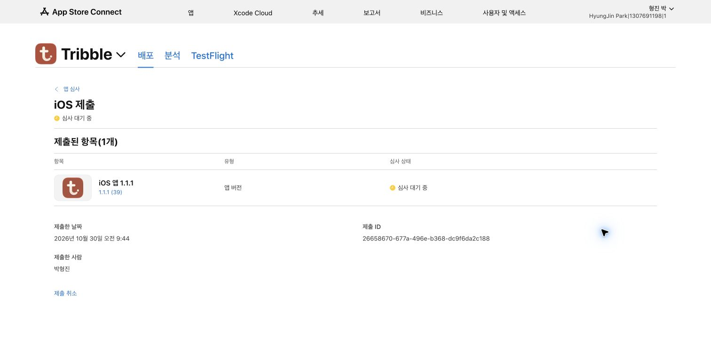

# Tribble 1.1.1(39) 배포 기록

2026-10-30 09:44 KST에 App Store 심사 제출을 완료했고 **심사 대기 중** 상태를 확인했습니다. 승인 후 자동 출시하며 모든 사용자에게 즉시 업데이트합니다. 기존 평점은 유지합니다. 아직 심사 승인이나 공개 출시 완료 상태는 아닙니다.

- EAS 빌드: `52537252-c866-4aeb-b9e1-e2db697a85d9` — FINISHED
- EAS 업로드: `aac6be84-5b95-46b0-bee6-323e9e94ce3c` — FINISHED
- Apple 빌드: `a2c6e375-4b9b-4064-a588-ba9383510112` — COMPLETE
- 내부 TestFlight 그룹: `테스터` / 1명, 한국어 테스트 안내 저장 확인
- App Store 심사 제출: `26658670-677a-496e-b368-dc9f6da2c188` — WAITING_FOR_REVIEW
- [App Store Connect 제출 화면](https://appstoreconnect.apple.com/apps/6753949093/distribution/reviewsubmissions/details/26658670-677a-496e-b368-dc9f6da2c188)

이번 재개 작업에서는 이미 완성된 서명 IPA와 업로드를 재사용했습니다. IPA 검증은 [build-39-verification.json](ios/build-39-verification.json), 업로드 상태는 [build-39-submission.json](ios/build-39-submission.json)에 있습니다. 앱 소스 68개 파일은 [빌드 39 소스 스냅샷](source-snapshot-build39.json)과 일치하며 앱 코드는 변경하지 않았습니다. Android는 새로 빌드하지 않았습니다.

한국어·영어 설명과 심사 안내를 저장했습니다. 영어 앱 이름 `Tribble`의 중복 오류를 해소하기 위해 영어 이름을 `Tribble: Day Trip Planner`로 등록했고 한국어 이름은 유지했습니다. 영어 지원·개인정보 URL을 기존 공개 문서에 연결했습니다. 실제 앱 기능을 검토해 새로운 소셜 미디어 질문을 포함한 연령 등급 설문을 완료했고 산정 등급은 4+입니다.

[최신 스크린샷](screenshots/README.md)은 iPhone과 iPad 각각 5장이며 기본 한국어 자산을 영어에서 상속합니다. 촬영용 시뮬레이터와 Metro는 종료했습니다. 공개 개인정보·지원 문서의 커밋과 전체 제출 설정은 [스토어 제출 기록](store-20261030-submission.json)에 보관했습니다.

